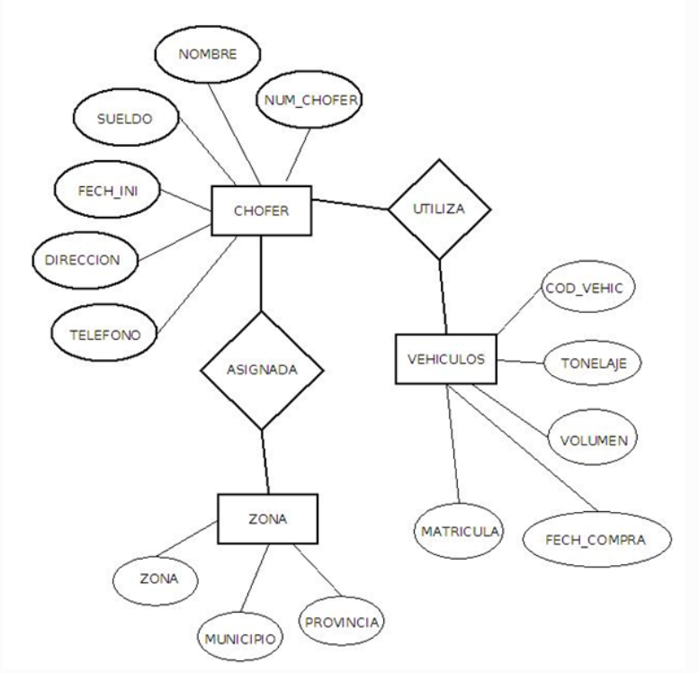

# IFCD0112 MF0226 SQL RDB 3 Diseño Lógico
Diseño lógico de una BD relacional a partir de un esquema E-R: tablas, claves, dominios y normalización.

## Enunciado:
Atendiendo al siguiente esquema conceptual realiza el diseño lógico de la base de datos:


- Pregunta 1. Partiendo del esquema conceptual proporcionado identifica las tablas, claves primarias y ajenas, índices y vistas.
- Pregunta 2. Describe el dominio de los atributos de las tablas indicando el rango o conjunto de valores que pueden tomar.
- Pregunta 3. Reconoce el grado de normalización de las tablas de la base de datos.
- Pregunta 4. Justifica las posibles desnormalizaciones del modelo.
- Pregunta 5. Indica las restricciones de integridad asociadas a cada una de las claves primarias y a las claves ajenas.

## Desarrollo:
### 1. Interrelaciones:
En el enunciado no vienen pero yo doy por hecho que son así:
- CHOFER – ZONA (N:1): Cada chófer está asignado a una sola zona, y en una zona trabajan varios chóferes.
- CHOFER – VEHICULOS (N:M): Un chófer puede conducir varios vehículos y un vehículo lo pueden conducir varios chóferes (por turnos, días, etc.).

### 2. Tablas:
[Ver código SQL](tablas3.sql)

### 3. Índices:
Los índices: para facilitar su búsqueda y lectura. Doy por hecho que lo que se va a querer consultar sobre todo es la zona de un chófer y el vehículo utilizado, así que:
```sql
CREATE INDEX idx_chofer_zona ON CHOFER(ZONA);
CREATE INDEX idx_uso_vehic ON USO(COD_VEHIC);
```
### Vistas:
[Ver código SQL](vistas.sql)

### 5. Normalización:
- 1FN: todas las tablas cumplen: tienen clave primaria y todos los atributos son atómicos (un solo valor por celda, sin grupos repetitivos). El único que podría preocupar es DIRECCION (calle, número, CP, localidad) pero he decidido considerarlo atómico porque no se va a consultar por partes, es como si se leyera de una. Esto se puede considerar desnormalización.
- 2FN: también cumplen todas. ZONA, CHOFER y VEHICULOS tienen clave primaria simple, así que no puede haber dependencias parciales. USO tiene clave compuesta, pero no tiene atributos no clave, por lo que tampoco pueden haber dependencias parciales.
- 3FN: el único problema que he detectado es que ZONA → MUNICIPIO → PROVINCIA. Ejemplo mío: Plaza de las Monjas siempre va a depender de Huelva capital porque es una zona de Huelva capital, pero Huelva capital no depende de Plaza de las Monjas, podría contener a la zona Parque Moret. Y además Huelva capital (municipio) depende de Huelva provincia sí o sí. Resultado = transitiva.
SOLUCIÓN: tabla aparte para MUNICIPIO con PROVINCIA dentro:
[Ver código SQL](solucion-3fn.sql)

## Feedback del profesor:
Estimado/a LAURA GIL ORTIZ,
Te informamos que tienes nuevas calificaciones disponibles referentes a UF2175_UD 3Actividad 3_Caso práctico correspondiente al grupo ED24-ED1-MF0226 - PROGRAMACIÓN DE BASES DE DATOS RELACIONALES (IFCD0112).

Dicha tarea ha sido evaluada con una nota de: 10

Mensaje: Has hecho un planteamiento muy completo y práctico: pasas el esquema conceptual a tablas con total coherencia, defines bien las claves, las restricciones referenciales y aportas índices y vistas bien justificados; además, tu análisis de la 3FN al detectar la dependencia transitiva en la zona y aislar el municipio es brillante.

Para cualquier consulta que se te plantee puedes contactar con el departamento académico a través de cualquiera de las vías que tienes a tu disposición.

Recibe un cordial saludo (TUTOR) MARIANO HOMERO GIRALDEZ RUBISTEIN .
